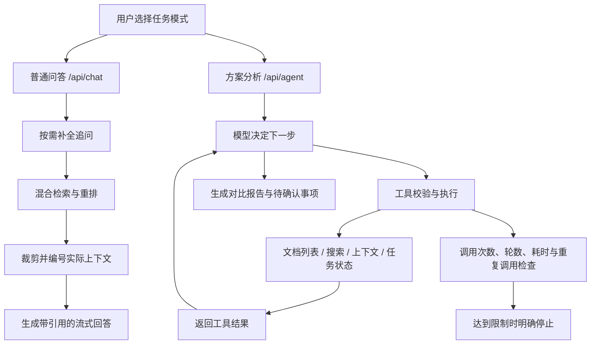

# DocMind — RAG 文档问答与技术方案分析 Agent

上传 PDF、Word、Markdown 或 TXT，在同一个知识库中完成两类任务：**检索问答**与**技术方案对比**。普通问题使用固定 RAG 流程；需要多次查找的分析任务使用单 Agent，由模型根据工具结果决定下一步操作。

[在线演示](https://42.192.115.149/docmind/) · [演示与使用说明](docs/upgrade-demo.md) · [验收与上线记录](docs/deployment-2026-11-10.md)

## 两种使用模式

| 模式 | 示例任务 | 工作方式与结果 |
|------|----------|----------------|
| 普通问答 · RAG | “缓存穿透如何处理？”接着追问“那另一种情况呢？” | 结合近期对话补全检索问题，混合检索与重排后流式回答，附实际传入模型的来源片段 |
| 方案分析 · Agent | “比较三份缓存方案的一致性、故障恢复和运维成本，列出依据与待确认问题。” | 制定比较维度，自主选择搜索或读取上下文，更新任务进度，输出带引用的 Markdown 报告 |

线上与互选网站共用服务器，DocMind 使用独立的 HTTPS `/docmind/` 入口；HTTPS 根路径属于互选网站。

前端可直接切换模式。Agent 模式展示任务清单、查找记录、停止状态，并支持复制报告；普通问答保留逐段流式输出。在线知识库内容可能变化，固定示例可用下文的本地演示文档复现。

## 本次升级

### 完善 RAG：追问与证据对应

- **追问补全**：把“那怎么解决？”结合近期对话补全为可检索的问题。单轮问题跳过；5 秒超时、异常或不合法输出回退原问题。可通过 `QUERY_REWRITE_ENABLED=false` 关闭。
- **实际上下文引用**：先裁剪片段，再将同一份文本用于生成和来源卡片，保留文档与片段编号，避免展示的证据与模型看到的内容不同。
- **资料不足时说明缺口**：没有检索结果时直接提示；有片段但缺少回答依据时要求说明资料不足，不擅自补充数据或优劣排名。模型仍可能判断错误，需要核对原文。
- **保留检索对照能力**：vector、BM25、RRF 混合检索、可选重排和三策略并排检索台；自写 BM25 与现成库逐分对拍。

### 增加 Agent：根据查找结果继续完成任务

Agent 的核心是工具调用循环：模型提出工具调用，服务端校验并执行，把结果交回模型；模型据此继续查找或交付报告。执行路径不固定为一次搜索后生成。

| 工具 | 职责 |
|------|------|
| `list_documents` | 分页查看文档编号与标题，每页最多 20 条 |
| `search_documents` | 复用混合检索与重排，每次最多返回 5 个证据片段 |
| `read_context` | 读取指定片段及相邻内容，每次最多 3 个片段 |
| `update_task` | 更新本次任务的步骤、完成项和证据缺口；使用整数步骤编号，服务端映射为显示文本 |

任务状态与证据只保留在本次请求内，每个请求独立创建。工具仅访问现有知识库或更新请求内状态，不修改用户文档。

执行上限为 **6 次工具调用、8 次模型回复、90 秒**。重复调用、无效参数和异常均明确反馈；刚好用完工具预算后，允许在剩余时间与轮数内总结已有证据。引用编号检查只验证来源是否存在，不能证明结论一定正确。

## 架构与执行流程

文档入库：解析多格式文件，分块后写入 SQLite 元数据、Chroma 向量库，并同步 BM25 索引。两种模式复用这些检索与正文读取能力。



Agent 通过 SSE 推送任务与工具事件，报告在分析结束后输出；当前不提供报告逐 token 生成。

## 如何演示

1. 按快速开始启动，在本地上传 [`scripts/sample_data/comparison/`](scripts/sample_data/comparison/) 中的三份方案。
2. 在“普通问答”中问“方案乙的更新顺序是什么？”，随后追问“等待多久？”。
3. 切换“方案分析 · Agent”，输入“对比三份方案的一致性、恢复方式和实现运维成本，列出适用条件与待确认问题”。
4. 查看任务进度和工具记录，核对报告引用，再尝试“哪份方案的生产 QPS 最高？”检查资料不足时的行为。

三份文档是简化演示材料，不是经过生产验证的技术建议。mock 模式只能检查执行流程；真实分析需要配置模型 API，调用会使用相应额度。完整步骤见[演示说明](docs/upgrade-demo.md)。

## 验证结果与限制

| 验证项 | 已完成结果 | 口径 |
|--------|------------|------|
| 离线回归 | Windows 与 Linux 均通过 127 项测试 | 使用替身和 MockTransport，测试隔离真实 API 凭据 |
| 真实 RAG 复测 | 20 条案例完成，无流式错误 | 覆盖单轮、追问、换话题、资料不足与对比问题 |
| 真实 Agent 复测 | 20 条案例完成，无工具错误，进度正常更新 | 检查工具预算、来源编号和目标证据覆盖 |
| 公网验收 | 普通问答、方案对比和 SSE 进度可用 | 保留线上原有数据与配置，已备份旧版本 |

真实案例使用三份短文档，由助手对照资料检查，**不是独立人工标注的盲测**。`upgrade_cases.json` 的 `reviewed` 保留为 false；这些结果不能外推复杂文档上的成功率，也不能据此宣称 Agent 在所有问题上更优。

验收中暴露并修复了两类具体问题：模型把定性描述扩大为无依据排名；模型改写步骤文本导致进度更新失败。后者改为整数步骤编号后，本批 20 条 Agent 复测未出现工具错误。详细过程见[验收记录](docs/deployment-2026-11-10.md)。

同题记录工具保留回答、来源、工具事件、耗时和人工评分空栏：

```bash
# 只检查案例，不调用服务或模型
python scripts/compare_modes.py --dry-run

# 先上传演示文档，再小范围记录两种模式的结果
python scripts/compare_modes.py --base http://127.0.0.1:8000 --limit 2

# 全量离线回归
python -m pytest -q
node --test tests/frontend_paths.test.cjs
```

## 技术栈

| 组件 | 选型 |
|------|------|
| 后端 | Python 3.12 + FastAPI + Pydantic v2 |
| 向量库 | Chroma（单机嵌入式，持久化落盘） |
| Embedding | 硅基流动 BAAI/bge-m3 |
| 关键词检索 | BM25（jieba 分词 + rank-bm25，SQLite 全量重建，自写 `MyBM25` 对拍验证） |
| 混合融合 | RRF 倒数排名融合（k=60） |
| 重排 | BAAI/bge-reranker-v2-m3（cross-encoder 精排候选集，可开关） |
| 检索评估 | 自建测试集（LLM 反向生成 + 人工抽查）+ 手写 recall@k/MRR + 网格实验 |
| 大模型 | DeepSeek：普通问答使用 SSE，Agent 使用工具调用；httpx 实现客户端 |
| 文档解析 | PyMuPDF / python-docx / charset-normalizer |
| 元数据 | SQLite（标准库） |
| 前端 | 原生 HTML / CSS / JS（单页，无框架） |
| 测试/压测 | pytest（127 个用例，全离线）/ locust（两场景报告 + 分段计时定位瓶颈） |

## 快速开始

```bash
# 获取代码
git clone https://github.com/Maple-in-rain/docmind.git
cd docmind

# 1. 创建环境（Python 3.12）
conda create -n docmind python=3.12 -y
conda activate docmind

# 2. 安装依赖
pip install -r requirements.txt

# 3. 配置 API key
cp .env.example .env
# 编辑 .env，填入 DEEPSEEK_API_KEY 和 SILICONFLOW_API_KEY
# DeepSeek:  https://platform.deepseek.com
# 硅基流动:  https://siliconflow.cn

# 4. 启动
uvicorn app.main:app --reload
# 浏览器打开 http://127.0.0.1:8000 使用应用
# http://127.0.0.1:8000/docs 查看接口文档

# Windows 控制台若中文日志乱码，用 UTF-8 模式启动：
# python -X utf8 -m uvicorn app.main:app --reload
```

## API 摘要

| 方法 | 路径 | 说明 |
|------|------|------|
| POST | `/api/documents/upload` | 上传文档并入库（multipart） |
| GET | `/api/documents` | 文档列表 |
| DELETE | `/api/documents/{doc_id}` | 删除文档（向量+元数据同步清理） |
| POST | `/api/search` | 检索调试（strategy: vector/bm25/hybrid，可选 rerank） |
| POST | `/api/agent` | 技术方案分析，SSE 推送任务状态、工具记录和报告 |
| POST | `/api/chat` | 聊天，默认 SSE 流式（`stream:false` 返回完整 JSON），支持多轮 |
| GET | `/api/health` | 健康检查 + 统计 |

完整接口文档：启动后访问 `/docs`。

## 项目结构

```
app/
├── agent/        # 方案分析：工具定义、请求内状态、模型驱动执行循环
├── api/          # 路由层（薄封装：参数校验 → 调用服务）
├── services/     # 编排层（入库 / 检索 / 追问补全 / 问答）
├── parsers/      # 文档解析插件（pdf/docx/md/txt + 注册表）
├── chunking/     # 分块策略插件（固定窗口，标题结构规划中）
├── embeddings/   # 向量化插件（硅基流动 API）
├── retrieval/    # 检索插件（向量库、BM25、RRF 融合）
├── reranking/    # 重排插件（bge-reranker 精排候选集）
├── llm/          # 大模型插件（DeepSeek 流式客户端）
└── storage/      # SQLite 元数据 + 文件落盘

eval/
├── metrics.py          # 手写 recall@k / MRR@k（含单测）
├── evaluate.py         # 网格实验：分块×重叠×策略×重排，一键复现
├── testset_builder.py  # DeepSeek 反向生成测试集
└── data/               # 原检索语料、84 条 QA、20 条升级案例与抽查记录

loadtest/
├── locustfile.py       # 压测任务（查询池与评估同源，含首 token 自定义事件）
└── seed_docs.py        # 种子数据：上传语料到运行中的实例

scripts/
├── compare_modes.py    # 记录同题 RAG / Agent 回答、来源、调用次数与耗时
└── sample_data/comparison/  # 三份可上传的简化技术方案

docs/
├── upgrade-demo.md     # 功能演示、使用方法和已知限制
└── deployment-2026-11-10.md # 真实 API 验收与上线记录

deploy/
├── setup_server.sh     # Ubuntu 一键部署（conda + systemd + nginx + swap）
├── docmind.service     # systemd 守护单元
└── nginx.conf          # 反向代理（SSE 流式：proxy_buffering off）
```

分层原则：**依赖抽象接口，不依赖具体实现** —— 换供应商只需新增插件类 + 改配置。

## 当前边界与后续工作

- 当前解析依赖文档文本层，扫描 PDF 的 OCR、复杂表格和页码定位尚未实现。
- 查询补全可能误解上下文；异常回退只能保证有退路，不能保证补全准确。
- Agent 只分析已上传资料，无联网搜索、长期记忆或多 Agent 协作。
- 超时或取消会阻止后续检索阶段、重试和证据写入；已发出的同步 HTTP 请求仍可能持续到自身超时。
- 入库跨 SQLite 与 Chroma 的失败清理、BM25 增量索引和大文件异步入库仍待完善。
- 下一步优先扩大有独立标注的困难案例，核对不同文档长度下的回答与引用质量。

## 历史检索实验与压测

以下保留升级前的检索实验和压测，便于复现与检查参数依据。它们不包含新增追问补全和 Agent 的性能，不能作为当前版本的端到端基准。

<details>
<summary>展开：36 组检索实验、数据口径与限制</summary>

## 检索质量评估（数据驱动，非拍脑袋）

**方法**：15 篇技术文档语料 → DeepSeek 按段落反向生成 84 条 QA（含答案出处段落，人工抽查 20%）→ 段落级相关性判定（检索块与出处段落余弦相似度 ≥ 0.8）→ 统一评估子集（58 条在所有分块配置下均可判定的查询）→ 36 格网格实验。指标为手写实现的 recall@k / MRR@10。一条命令复现：

```bash
python -X utf8 -m eval.testset_builder   # 生成/重建测试集
python -X utf8 -m eval.evaluate          # 全量网格（断点续跑，只补缺）
```

**结果**（58 条统一子集，按 recall@10 降序）：

| 配置 | recall@3 | recall@5 | recall@10 | MRR@10 |
|------|----------|----------|-----------|--------|
| chunk256_o0_vector_on | 0.9310 | 0.9655 | 1.0000 | 0.9253 |
| chunk256_o0_bm25_on | 0.9397 | 0.9741 | 1.0000 | 0.9253 |
| chunk512_o0_vector_on | 0.9914 | 1.0000 | 1.0000 | 0.9655 |
| chunk512_o0_bm25_on | 0.9914 | 1.0000 | 1.0000 | 0.9655 |
| chunk512_o0_hybrid_on | 0.9914 | 1.0000 | 1.0000 | 0.9655 |
| chunk512_o50_vector_off | 0.9224 | 0.9655 | 1.0000 | 0.8886 |
| chunk512_o50_vector_on | 1.0000 | 1.0000 | 1.0000 | 0.9569 |
| chunk512_o50_bm25_on | 1.0000 | 1.0000 | 1.0000 | 0.9569 |
| chunk512_o50_hybrid_off | 0.9828 | 0.9914 | 1.0000 | 0.9138 |
| chunk512_o50_hybrid_on | 1.0000 | 1.0000 | 1.0000 | 0.9569 |
| chunk768_o0_vector_off | 1.0000 | 1.0000 | 1.0000 | 0.9540 |
| chunk768_o0_vector_on | 0.9914 | 1.0000 | 1.0000 | 0.9741 |
| chunk768_o0_bm25_on | 0.9914 | 1.0000 | 1.0000 | 0.9741 |
| chunk768_o0_hybrid_off | 0.9828 | 1.0000 | 1.0000 | 0.9690 |
| **chunk768_o0_hybrid_on** | 0.9914 | 1.0000 | 1.0000 | **0.9741** |
| chunk768_o50_vector_off | 1.0000 | 1.0000 | 1.0000 | 0.9511 |
| chunk768_o50_vector_on | 0.9914 | 1.0000 | 1.0000 | 0.9741 |
| chunk768_o50_bm25_on | 0.9914 | 1.0000 | 1.0000 | 0.9741 |
| chunk768_o50_hybrid_off | 0.9828 | 1.0000 | 1.0000 | 0.9690 |
| chunk768_o50_hybrid_on | 0.9914 | 1.0000 | 1.0000 | 0.9741 |
| chunk256_o50_vector_on | 0.8678 | 0.9425 | 0.9943 | 0.8721 |
| chunk256_o0_hybrid_on | 0.9310 | 0.9655 | 0.9914 | 0.9253 |
| chunk512_o0_bm25_off | 0.9741 | 0.9828 | 0.9914 | 0.9195 |
| chunk512_o0_hybrid_off | 0.9741 | 0.9914 | 0.9914 | 0.9345 |
| chunk512_o50_bm25_off | 0.9741 | 0.9828 | 0.9914 | 0.9195 |
| chunk256_o50_bm25_on | 0.8851 | 0.9598 | 0.9885 | 0.8736 |
| chunk256_o50_hybrid_on | 0.8678 | 0.9425 | 0.9856 | 0.8721 |
| chunk768_o0_bm25_off | 0.9828 | 0.9828 | 0.9828 | 0.9368 |
| chunk768_o50_bm25_off | 0.9828 | 0.9828 | 0.9828 | 0.9454 |
| chunk256_o0_bm25_off | 0.8276 | 0.9052 | 0.9741 | 0.8602 |
| chunk256_o0_hybrid_off | 0.8793 | 0.9569 | 0.9741 | 0.8583 |
| chunk512_o0_vector_off | 0.9397 | 0.9569 | 0.9741 | 0.8966 |
| chunk256_o50_hybrid_off | 0.8161 | 0.9310 | 0.9626 | 0.8382 |
| chunk256_o0_vector_off | 0.8362 | 0.9224 | 0.9569 | 0.8520 |
| chunk256_o50_vector_off | 0.7644 | 0.8707 | 0.9483 | 0.8037 |
| chunk256_o50_bm25_off | 0.7931 | 0.8793 | 0.9454 | 0.8279 |

**结论（默认参数据此定稿）**：

1. **重排是最大的单一变量**：小分块下把 recall@3 平均拉升约 10pp（chunk256 bm25 0.83→0.94），大分块下 MRR 仍稳定提升——「宽召回 + 精排序」在本语料上成立；
2. **分块 256 过碎**（段落被切断、上下文不足），512/768 显著更优；768 分块自带充足上下文，与 512 差距在噪声内，重叠收益趋零——默认取 768/0，块数最少、效果相同；
3. **重排开启后三策略趋同**：重排吸收了混合融合的收益，当前表中 hybrid 与单路的差距取决于分块配置，并不总是领先；保留 hybrid + 重排作为当前默认，但不能据此宣称普遍更优；
4. 系统默认参数 chunk 768 / 无重叠 / hybrid / rerank on 均参考本表，可用 `eval/evaluate.py` 复现。

**评估限制**：语料仅 15 篇，58 条统一子集中的多组指标接近饱和；相关性标签由同一 embedding 模型辅助判定，可能偏向该模型的相似性判断。结果不代表独立人工标签或更大语料上的泛化效果。新增 20 条升级案例尚待人工审阅，不能当作已验证的收益。


</details>

<details>
<summary>展开：历史 RAG 压测、计数修正与复现方法</summary>

## 性能压测（locust，两场景）

**口径**：15 篇语料灌库（26 个 chunk，`loadtest/seed_docs.py`）；查询池 = 评估测试集 84 条真实问题；每场景 180 秒，报告为 P50/P95/P99（本机 Windows 20 逻辑核，实测值）。

| 场景 | 目的 | provider | 并发 |
|------|------|----------|------|
| 场景 1 端到端延迟 | 真实用户体验（含外部 API 延迟） | 全真实（硅基流动 + DeepSeek） | 3（1~3s 思考） |
| 场景 2 系统吞吐 | 测系统自身极限（排除外部 API） | 全 mock（离线确定性实现） | 50（零思考） |

| 指标 | 场景 1 | 场景 2 |
|------|--------|--------|
| /api/search P50 / P95 / P99 | 630 / 860 / 3400 ms | 130 / 210 / 260 ms |
| /api/chat 首 token P50 / P95 | 1100 / 1500 ms | 80 / 150 ms |
| /api/chat 全量 P50 / P95 / P99 | 2400 / 3700 / 4300 ms | 270 / 380 / 450 ms |
| RPS / 失败率 | ~1.5 / 0%（含思考时间） | search 143 + chat 71 ≈ 214 业务请求/s（统计事件聚合 357）/ 0% |

**分段计时**（PERF_LOG=1，单请求归因；外部 API 延迟含网络往返）：

| 分段 | 耗时 | 类型 |
|------|------|------|
| embed（查询向量化） | 170~240 ms | 外部 API |
| vector_query（Chroma） | ~1.5 ms | 本地 |
| bm25（jieba + 打分） | ~0.2 ms | 本地 |
| db_fetch（SQLite 回填） | ~0.6 ms | 本地 |
| rerank（cross-encoder） | 330~400 ms | 外部 API |
| llm_first_token / llm_total | ~550 / ~1330 ms | 外部 LLM |

**结论**：

1. **延迟大头全在外部 API**：embed + rerank + LLM 首 token 占端到端 ~95%，本地组件（Chroma / SQLite / BM25 / RRF）全部 ≤2ms——这些数字仅覆盖本次小语料与测试条件，不能外推大规模性能；
2. **系统自身吞吐足够**：全 mock 50 并发零思考时间，约 6.4 万统计事件未记录失败；聊天的 headers、first-token、full-answer 重复计入聚合，每个业务请求只应计一次，search 143 rps / chat 71 rps，合计约 214 业务请求/s；场景 2 的 P50 主要来自高并发排队（FastAPI 同步端点线程池 40 + `to_thread` 默认线程池），而非计算；
3. **场景 2 检索结果无语义**（mock 哈希向量），但每条代码路径与真实一致，仅适合观察 mock 条件下的服务开销，不能代表真实模型场景的吞吐；
4. 场景 1 P99 长尾（3.4s）的具体原因需要结合请求日志进一步验证，不能保证更换 key 即可消除；优化方向：embed/rerank 改异步 httpx + 共享连接池（现状每次调用新建连接，TLS 握手按次付费）。

**复现**：

```bash
# 灌种子（一次）
python -X utf8 loadtest/seed_docs.py --base http://127.0.0.1:8000
# 场景 1：真实 provider 低并发
python -X utf8 -m locust -f loadtest/locustfile.py --host http://127.0.0.1:8000 \
  --headless -u 3 -r 1 -t 180s --csv=locust_report_scenario1 --html=locust_report_scenario1.html
# 场景 2：全 mock 高并发（服务器用三个 PROVIDER=mock 环境变量启动）
DOCMIND_WAIT_MIN=0 DOCMIND_WAIT_MAX=0.1 python -X utf8 -m locust -f loadtest/locustfile.py \
  --host http://127.0.0.1:8000 --headless -u 50 -r 10 -t 180s --csv=locust_report_scenario2 --html=locust_report_scenario2.html
# 定位瓶颈：PERF_LOG=1 启动服务后发请求，日志输出每段耗时
```


</details>

## License

MIT
